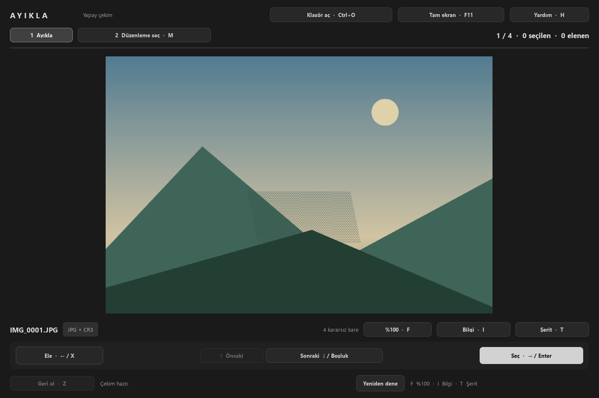

# Ayikla

**Find your best frames. Build your shortlist.**

A simple, keyboard-first Windows photo culling app for Canon RAW+JPEG shoots. First choose what to keep, then pick what to edit in Lightroom.

**Windows x64 · English interface · JPG/JPEG + Canon CR3 · 1.1.2b1 Beta**

### [Download for Windows · ZIP](https://github.com/Firextream/Ayikla/releases/download/v1.1.2b1/Ayikla-1.1.2b1-Windows-x64.zip)

[Release notes](https://github.com/Firextream/Ayikla/releases/tag/v1.1.2b1) · [Share feedback](https://github.com/Firextream/Ayikla/issues/new?template=feedback.md) · [Report a bug](https://github.com/Firextream/Ayikla/issues/new?template=bug_report.md)

*The photos in these screenshots are generated test images, not personal photographs.*

## Get started

1. Download the Windows ZIP above and extract **the entire archive**. GitHub's “Source code” archives are not the runnable app.
2. Open `Ayikla/Ayikla.exe`. **No Python installation needed.** Keep `_internal` next to the executable.
3. Choose **Open folder** and select the folder containing your JPEGs. Start with a separate copy of 20–50 photo pairs for your first beta test.

The package is unsigned, so Windows may show a warning. If it will not open, report the exact message; do not disable your security software. The included `MasaustuKisayolu.ps1` script can create an optional desktop shortcut without overwriting an existing one.

## Keep or pick for editing?

| Round | Your decision | What happens to the files |
|---|---|---|
| **1 · Keep / Reject** | Which frames should I keep? | Keep moves JPG + matching CR3 to `01_secilen`; Reject moves them to `_red`. |
| **2 · Edit / Lightroom** | Which kept frames should I edit? | Press M, then E to **copy** JPG + CR3 into `02_edit`. |

**Delete means Reject, not permanent deletion.** Z undoes the last decision, including after restarting the app. Decisions are saved automatically; there is no separate Save button. Import `02_edit` into Lightroom Classic yourself.

Folder names stay the same as earlier Turkish builds so existing shoots and journals continue to work.

## Keyboard

| Key | Action |
|---|---|
| → / Enter | Round 1: Keep → `01_secilen` |
| ← / X / Delete | Round 1: Reject → `_red`; no permanent deletion |
| Space / ↓ | Next photo without deciding; show summary at the end of round 2 |
| ↑ | Previous photo |
| Z | Undo the last decision, including after a restart |
| M | Switch between culling and edit picks |
| E | Round 2: copy to `02_edit`; press again to remove the edit pick |
| F | 100% focus check / fit to window |
| Drag with left mouse button | Pan while zoomed in |
| I | EXIF: filename, time, shutter, aperture, ISO, focal length, lens |
| T | Toggle filmstrip; click a thumbnail to jump |
| H / ? | Keyboard help and app version |
| Ctrl+O | Open another shoot folder |
| F11 | Toggle full screen |
| Esc | Close help, then leave zoom, then leave full screen |

## Inspect your photos and reach your files

The **Folders** menu opens the shoot, kept, rejected or edit folder in Explorer and shows current counts. **Open folder ↗** below the photo opens that photo's current folder. The round summary also links to kept and rejected files.

Filmstrip edges: **green = kept, red = rejected, purple = picked for editing**. Rejected photos can be previewed; decision keys are disabled during that preview. Capture times within one second show a **Burst 2/5** hint. Missing EXIF fields show “—”.

Normal previews and thumbnails use scaled decoding; full-resolution decoding is used only for 100% zoom. The last five folders and window/fullscreen state are remembered.

See focus check, EXIF, filmstrip and round summary

**100% focus check**

**Photo information**

**Filmstrip**

**Round summary**

## File safety

- No photo deletion and no overwriting existing destinations. `_red` is never emptied by the app.
- Removed edit copies are moved to `.ayikla_saklanan`. Keep that folder and `ayikla_log.jsonl` for recovery and undo.
- File operations are journaled before they run. On reopening, interrupted operations are recovered when possible. **Retry** retries recovery and rescans the folder after external changes.
- macOS `._*`, `Thumbs.db`, `desktop.ini`, `.DS_Store` and Windows hidden/system files are ignored. They are not counted, displayed, moved or copied.
- A corrupt JPEG can still be kept or rejected. JPEGs that failed to open during the current session appear in the round summary.

Keep an independent backup of your original shoot. The app moves files in the folder you select. It scans immediate JPG/JPEG files only, pairs CR3 files by case-insensitive filename stem, and does not recurse into other folders.

Portable preferences are stored in `ayikla_settings.jsonl` beside the executable. If that file cannot be read, the app starts with defaults and displays a notice. The shareable release ZIP does not include personal settings or shoot journals.

## Help shape the beta

We especially want feedback on the **Keep vs Edit distinction**, navigation speed, focus checking and folder access. [Share your experience](https://github.com/Firextream/Ayikla/issues/new?template=feedback.md) or [report a reproducible bug](https://github.com/Firextream/Ayikla/issues/new?template=bug_report.md). A GitHub account is required. Reports in English or Turkish are welcome.

Include the version shown in H help, Windows version, display scaling, camera and approximate photo count. Do not post private photos, personal paths, settings files or complete shoot journals.

The package is tested on Windows 11 x64 with generated JPEGs and dummy CR3 files. Other computers, high DPI/multiple monitors, real card disconnection and ICC/color accuracy still need field testing. Minimum window size is 1024×680 logical pixels. CR3 images are not decoded; other RAW formats and automatic Lightroom import are not supported.

[Five-minute beta guide](BETA.md) · [Validation and benchmark report (Turkish)](RAPOR.md) · [Run from source and build](docs/GELISTIRME.md)

Python 3.12 + PySide6; Pillow reads EXIF headers only. Third-party license notices are included in [licenses](licenses/NOTICE.txt) and the app package. No open-source license has been selected for Ayikla's own source yet.
