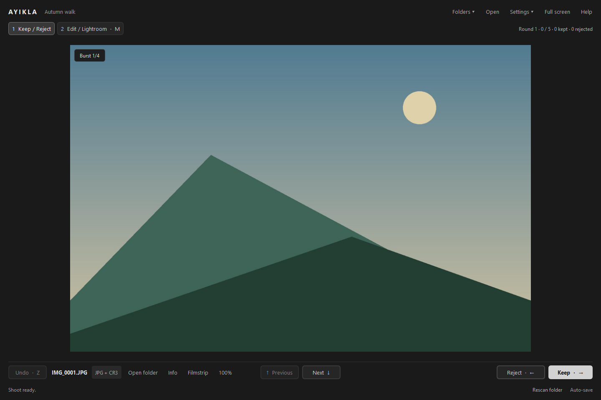
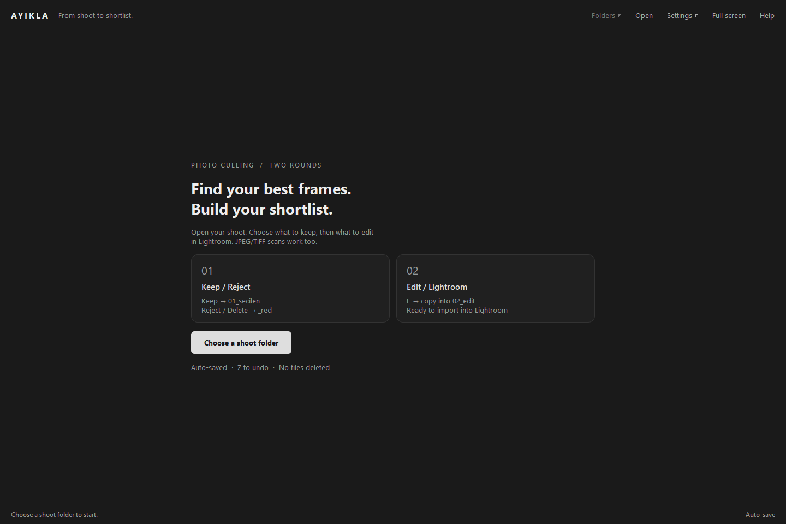
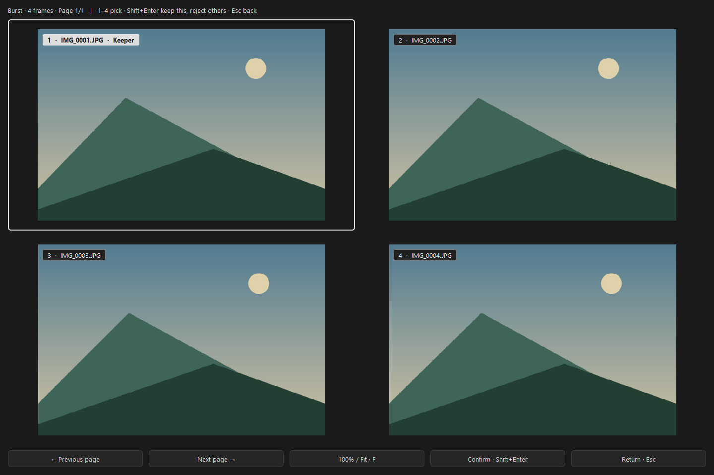
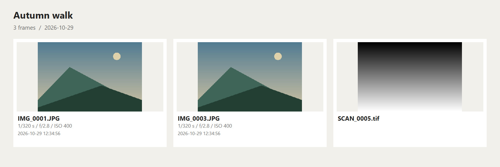
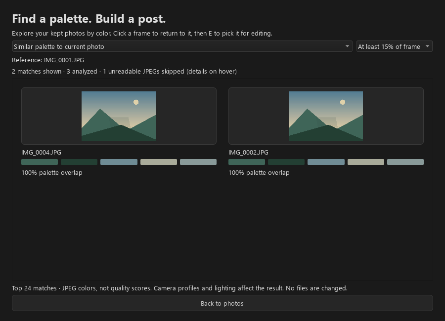
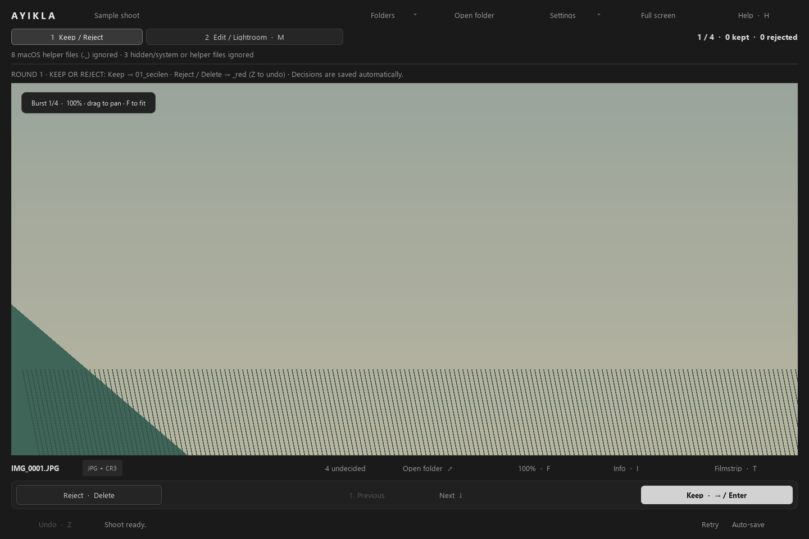
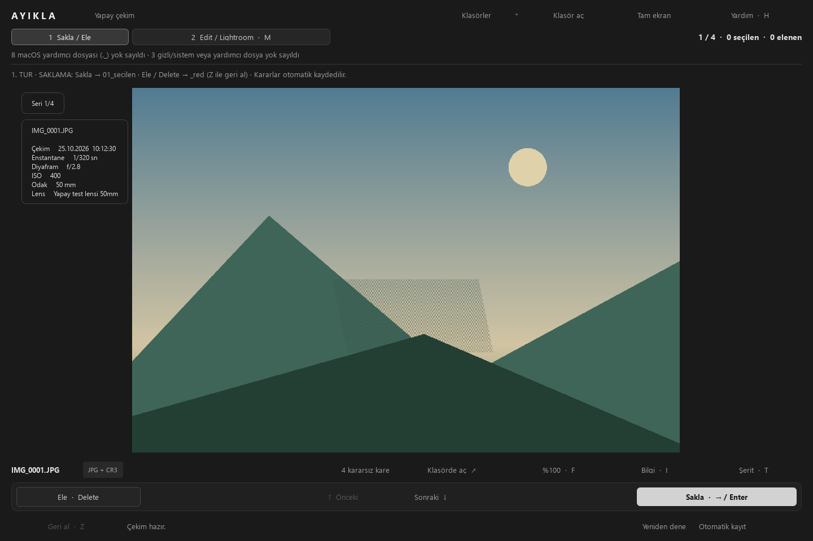
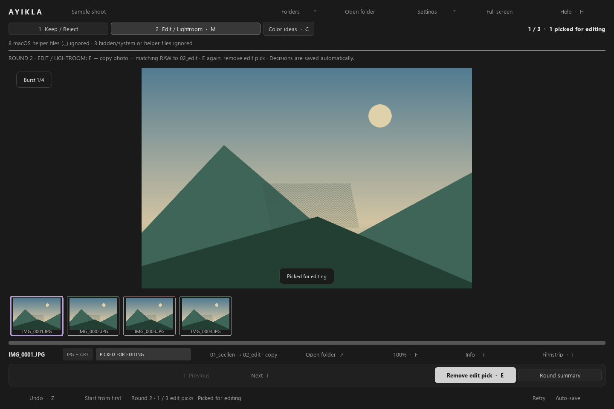
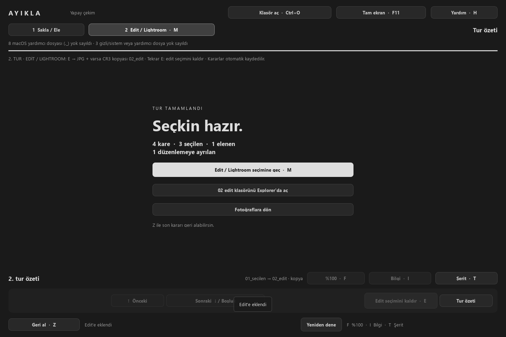

# Ayikla

**Find your best frames. Build your shortlist.**

A simple, keyboard-first Windows photo culling app for RAW+JPEG shoots. First choose what to keep, then pick what to edit in Lightroom.

**Windows x64 · beta · MIT**

[Download Windows ZIP](https://github.com/Firextream/Ayikla/releases/download/v1.6.0b1/Ayikla-1.6.0b1-Windows-x64.zip) · **Latest: [v1.6.0b1](https://github.com/Firextream/Ayikla/releases/tag/v1.6.0b1)**

[Release notes](docs/releases/v1.6.0b1.md) · [Share feedback](https://github.com/Firextream/Ayikla/issues/new?template=feedback.md) · [Report a bug](https://github.com/Firextream/Ayikla/issues/new?template=bug_report.md)

<table>
  <tr>
    <td width="33%"> Open a shoot</td>
    <td width="33%"> Compare a burst</td>
    <td width="33%"> Share your shortlist</td>
  </tr>
</table>

*The photos in these screenshots are generated test images, not personal photographs.*

## Get started

1. Download the Windows ZIP above and extract **the entire archive**. GitHub's “Source code” archives are not the runnable app.
2. Open `Ayikla/Ayikla.exe`. **No Python installation needed.** Keep `_internal` next to the executable.
3. Choose **Open** and select the folder containing your JPEGs. Start with a separate copy of 20–50 photo pairs for your first beta test.

The package is unsigned, so Windows may show a warning. If it will not open, report the exact message; do not disable your security software. The included `MasaustuKisayolu.ps1` script can create an optional desktop shortcut without overwriting an existing one.

## Keep or pick for editing?

| Round | Your decision | What happens to the files |
|---|---|---|
| **1 · Keep / Reject** | Which frames should I keep? | Keep moves JPG + matching RAW to `01_secilen`; Reject moves them to `_red`. |
| **2 · Edit / Lightroom** | Which kept frames should I edit? | Press M, then E to **copy** JPG + RAW into `02_edit`. |

**Reject · ←** in Fast culling moves the photo and matching RAW to `_red`; X / Delete also reject in either arrow-key mode. Z undoes the last decision, including after restarting the app. Decisions are saved automatically; there is no separate Save button. Import `02_edit` into Lightroom Classic yourself.

Folder names stay the same as earlier Turkish builds so existing shoots and journals continue to work.

## Keyboard

On first launch Ayikla asks how the arrow keys should work; change it any time in **Settings → Arrow keys**.

| Arrow keys | Fast culling (default) | Browse first |
|---|---|---|
| Keep → `01_secilen` | → / Enter | Enter |
| Reject → `_red` (no permanent deletion) | ← / X / Delete | X / Delete |
| Previous / next without deciding | ↑ / ↓ | ← / → (↑ / ↓ too) |

In both modes Backspace / PageUp go back, Space / PageDown go forward (the end of
round 2 shows the summary), and every Reject shows "Rejected IMG_0001 · Z to undo"
for three seconds. Clicking the left / right third of the photo also steps back /
forward; double-click in the middle is 100% / Fit. The **Undo · Z**, **Previous**
and **Next** buttons sit in the row with Reject and Keep.

| Key | Action |
|---|---|
| Z | Undo the last decision, including after a restart |
| M | Switch between culling and edit picks |
| E | Round 2: copy to `02_edit`; press again to remove the edit pick |
| C | Round 2: color ideas — tone filter and similar palettes |
| B | Compare the current burst: 2 panes for two frames, 4 for larger bursts |
| 1–4 in compare | Select the keeper in the current page; no files change yet |
| Shift+Enter in compare | Keep selected, reject the rest of the entire burst; one Z undoes the group |
| ← / → in compare | Previous / next page of a large burst |
| F | 100% focus check / fit to window |
| Drag with left mouse button | Pan while zoomed in |
| I | EXIF: filename, time, shutter, aperture, ISO, focal length, lens |
| T | Toggle filmstrip; click a thumbnail to jump |
| H / ? | Keyboard help and app version |
| Ctrl+O | Open another shoot folder |
| Ctrl+I | Import verified copies from a card or folder |
| Ctrl+Shift+E | Round 2 summary: export a contact sheet; check Also save PDF for a PDF copy |
| F11 | Toggle full screen |
| Esc | Close help, then leave zoom, then leave full screen |

In burst compare, F changes zoom in every pane and dragging pans them together.
Esc returns to the kept frame after confirmation. Existing edit picks must be
unmarked before changing a burst decision. Burst detection uses consecutive
capture times at most one second apart; suggestions never decide for you.

## Resume and progress

Each shoot's `ayikla_log.jsonl` remembers the round, current filename and capture
time. Reopen the folder or a recent folder to resume, with a small notification.
**Start from first** returns to the first photo of the current round without
changing any decisions. The bookmark travels with the shoot folder. If the
photo was moved or renamed, Ayikla chooses the nearest undecided capture time;
with no timestamps it uses natural filename order. In round 2 the fallback
prefers kept photos not yet picked, then undecided round 1 photos if needed.

The single top-right progress line shows round 1 decided/total, kept and rejected counts. After ten decisions in the current
session it adds an approximate remaining time based on the median seconds per
frame (burst decisions count their newly decided frames). It resets when opening
another shoot; previous sessions are not included. Round 2 shows the current position and edit-pick counts.

The photo now has a quieter two-row footer and 16 px fit margins. Round instructions
are in Help; ignored helper-file counts are in Folders. Start-screen cards wrap
their text. Burst comparison uses a 2 px keeper border and image-corner number
badges. See [before/after screenshots at 100% and 125%](docs/polish-1.5/README.md) and the
[1.6 review screenshots at 100/125/150%](docs/polish-1.6/README.md).

The next two and previous one photos are decoded in background threads. This was
already enabled in 1.4 and remains enabled in 1.5. A same-machine test on 300
generated 24 MP JPEGs measured preloaded Next at **4.48 → 4.24 ms median** and
**6.45 → 4.90 ms P95**, including QWidget painting. A cleared-cache read remains
about 104 ms; arbitrary cold jumps are not covered by the sub-100 ms preload
result. See [the navigation benchmark](docs/benchmark/navigation-1.5.md) for the
method, Previous timings, sustained navigation and raw results.

## Import from a card

Press **Ctrl+I**, or **Settings → Import from card**. Removable drives with a
DCIM folder are offered first. Choose the card/source, an existing destination
root and a shoot name; the dialog shows the folder it will create
(`2026-10-29_club`) and, while copying, files, size and remaining time. Long paths
show as `E:\…\DCIM\100CANON` with the full path in the tooltip. The last destination root is
remembered. Ayikla scans nested source folders and copies supported JPEG, TIFF
and RAW files into `<root>/YYYY-MM-DD_<name>`; card folders are flattened.
Every new copy is checked by size and SHA-256 before publication. Source files
are never changed. Identical copies are skipped, including photos already moved
to kept/rejected folders; different contents or ambiguous partners produce an
error instead of overwriting. A later RAW partner follows its existing preview.

Cancel keeps fully verified files and removes only incomplete private `.part`
staging data. One Z archives the new files from that import batch; skipped files
are untouched. Undo works after restarting. Keep `ayikla_import.jsonl` with the
shoot alongside its main journal and archive. An import cannot target a folder
inside the source/card. Folder links and hidden/helper files are not imported.

## Share a contact sheet

In the **round 2 summary**, choose **Export contact sheet**, or Ctrl+Shift+E.
Check **Also save PDF** for an optional PDF of the same grid on A4 pages (15 mm
margins; the content also fits US Letter; pages break between rows). The sheet is
titled with the shoot name and date and contains only edit picks, three columns up
to nine picks and four above. Each preview shows its filename and the exposure,
lens and capture-time lines that exist; a scan without EXIF shows just its name. It is saved as `02_edit/contact_sheet_<date>.jpg`
(and `.pdf`). Existing exports receive `_2`, `_3`, etc.; nothing is overwritten.
One Z archives both outputs together. Portrait and landscape images fit without
cropping; unavailable previews are labeled. Very large sheets are limited to
80 megapixels / 65,000 pixels in height; use a smaller shortlist when prompted.

## Lightroom sidecars

**Settings → Write Lightroom XMP sidecars** is on by default. Keep writes one
star and a Pick flag (`xmpDM:pick=1`); edit copies in `02_edit` get three stars;
Reject writes `xmp:Rating=-1` and `xmpDM:pick=-1`. The sidecar uses the RAW stem,
or the JPEG/TIFF stem when there is no RAW. Image files are never edited.
Existing XMP is archived in `.ayikla_saklanan` before replacement. Other fields,
including Camera Raw settings, color labels, comments and formatting, survive.
Undo restores the exact prior XMP bytes, even after restarting or disabling XMP.
Malformed or unsupported XMP blocks the decision with an error instead of losing metadata.

Import the edit folder manually, or use Lightroom's **Metadata → Read Metadata
from Files** for already imported photos. Lightroom Classic 13.2 introduced XMP
flag support ([Adobe documentation](https://helpx-origin.aws116.adobeitc.com/ie/lightroom-classic/help/flag-label-rate-photos.html)).
JPEG/TIFF sidecar handling can vary between editors; test the handoff in your
Lightroom version. Ayikla never embeds metadata into JPEG, TIFF or DNG files.

## Film scans and writing-app handoff

Standalone JPG/JPEG and TIF/TIFF files work automatically, including mixed
folders with RAW pairs. The same move/copy/undo controls apply. Missing EXIF
fields show “—”. TIFF previews use Pillow's thumbnail/reduction path; 16-bit
grayscale is downconverted only for display, and Color ideas also accepts TIFF.
Some TIFF codecs must decode the original before reducing it, so large scans
can use substantial transient memory. Multipage TIFF previews use the first page.

Edit-pick changes and the round 2 summary write/refresh
`02_edit/ayikla_picks.json`, including capture metadata, palette swatches and an
empty caption. Yazı can consume it independently; see the
[versioned schema](docs/picks-schema.md). The previous JSON is archived and
selection undo restores it.

## Color ideas for your next post

In **round 2**, press **C** or **Color ideas**. Choose a tone (red, orange, yellow, green, teal, blue, purple, pink, dark, neutral or light), then require it to cover at least 15%, 30% or 50% of the frame. Or choose **Similar palette to current photo** to find frames that could work together in a post.

Up to 24 matches show thumbnails, palette swatches and color coverage or palette overlap. Click a frame to return to it, then **E** to pick it for editing. Suggestions never automatically select, move or copy anything. Unreadable photos are skipped and listed in the round summary. Analysis runs locally in the background; closing the panel cancels it. Unchanged image descriptors are reused for the current app session.

These are approximate preview color matches, not assessments of composition or photographic quality. Recognized embedded color profiles are converted to sRGB for analysis; untagged images are treated as sRGB. Camera style, scan processing and lighting influence the suggestions. This does not change the photos or apply a grade to RAW files.

## Camera support

| Camera family | Paired RAW extensions |
|---|---|
| Fujifilm | RAF |
| Sony | ARW, SRF, SR2 |
| Olympus / OM System | ORF |
| Canon | CR3, CR2, CRW |
| Nikon | NEF, NRW |
| Panasonic / Leica | RW2, RWL |
| Pentax / Samsung | PEF, SRW |
| DNG cameras / phones | DNG |

A matching **JPG/JPEG with the same filename stem** is required for RAW pairing. RAW files are moved/copied as opaque files; they are not decoded, and support is not a claim that every camera model has been field-tested. Standalone JPEG/TIFF scans also work. RAW-only, HEIC and differently named JPEG/RAW pairs are not supported. If multiple RAW formats share one preview stem, Ayikla reports a conflict rather than guessing. Existing shoot folders and journals remain readable; shoots using new 1.3 operations require 1.3 or later.

## Inspect your photos and reach your files

The **Folders** menu opens the shoot, kept, rejected or edit folder in Explorer and shows current counts. **Open folder** below the photo opens that photo's current folder. The round summary also links to kept and rejected files.

Filmstrip edges: **green = kept, red = rejected, purple = picked for editing**. Rejected photos can be previewed; decision keys are disabled during that preview. Capture times within one second show a **Burst 2/5** hint. Missing EXIF fields show “—”.

Normal JPEG previews and thumbnails use scaled decoding; full-resolution output is requested only for 100% zoom. TIFF previews are reduced through Pillow, with the codec memory limitation described above. The last five folders and window/fullscreen state are remembered.

See focus check, EXIF, filmstrip and round summary

**100% focus check**

**Photo information**

**Filmstrip**

**Round summary**

## File safety

- No photo deletion and no overwriting existing destinations. `_red` is never emptied by the app.
- Removed edit copies are moved to `.ayikla_saklanan`. Keep that folder and `ayikla_log.jsonl` for recovery and undo.
- File operations are journaled before they run. On reopening, interrupted operations are recovered when possible. **Rescan folder** retries recovery and re-reads the folder after external changes.
- macOS `._*`, `Thumbs.db`, `desktop.ini`, `.DS_Store` and Windows hidden/system files are ignored. They are not counted, displayed, moved or copied.
- A corrupt JPEG can still be kept or rejected. JPEGs that failed to open during the current session appear in the round summary.

Keep an independent backup of your original shoot. The app moves files in the folder you select. It scans immediate JPG/JPEG files only, pairs supported RAW files by case-insensitive filename stem, and does not recurse into other folders.

Portable preferences are stored in `ayikla_settings.jsonl` beside the executable. If that file cannot be read, the app starts with defaults and displays a notice. The shareable release ZIP does not include personal settings or shoot journals.

## Help shape the beta

We especially want feedback on the **Keep vs Edit distinction**, navigation speed, focus checking and folder access. [Share your experience](https://github.com/Firextream/Ayikla/issues/new?template=feedback.md) or [report a reproducible bug](https://github.com/Firextream/Ayikla/issues/new?template=bug_report.md). A GitHub account is required. Reports in English or Turkish are welcome.

Include the version shown in H help, Windows version, display scaling, camera and approximate photo count. Do not post private photos, personal paths, settings files or complete shoot journals.

**276 tests passed**, including reopening and undoing a journal from the previous Turkish release. Windows DPI render checks cover 100%, 125% and 150%; the package is exercised on Windows 11 x64 with generated JPEGs and dummy RAW files. Other computers, multiple monitors, real card disconnection and ICC/color accuracy still need field testing. Minimum window size is 1024×680 logical pixels. RAW images are not decoded; automatic Lightroom import is not supported.

[Five-minute beta guide](BETA.md) · [Validation and benchmark report (Turkish)](RAPOR.md) · [Run from source and build](docs/GELISTIRME.md)

Python 3.12 + PySide6; Pillow reads EXIF headers only. Third-party license notices are included in [licenses](licenses/NOTICE.txt) and the app package. Ayikla's own source is released under the [MIT License](LICENSE).
